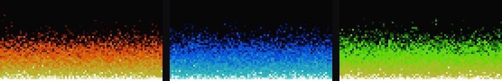
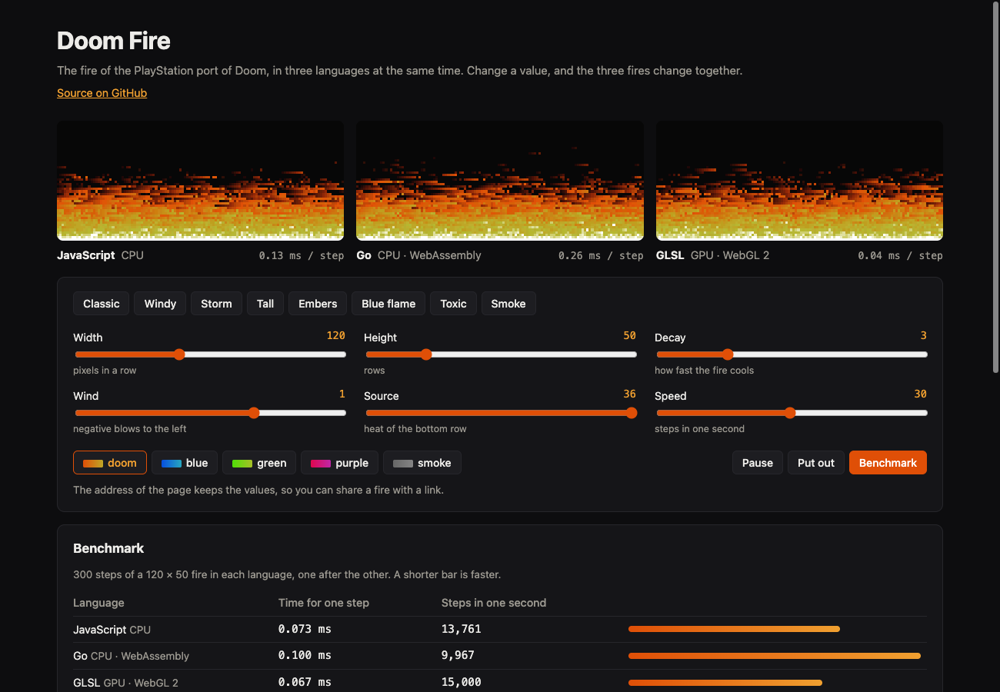

# Doom Fire



The fire effect of the PlayStation port of Doom, in five languages: Go, JavaScript, GLSL, C, and Python. A web page runs three of them side by side with the same parameters: JavaScript on the CPU, Go compiled to WebAssembly, and GLSL on the GPU. Change a value, and the three fires change together.

[](https://github.com/rahelmartim/doom-fire/actions/workflows/ci.yml)
[](https://rahelmartim.github.io/doom-fire/)



The page shows three fires, the parameters, and a benchmark. To try it, open the [live demo](https://rahelmartim.github.io/doom-fire/).

## The algorithm

The fire is a grid of intensities from 0 (black) to 36 (white). Each intensity has a color in a palette of 37 colors. Each step does two things:

1. The bottom row gets the intensity of the source.
2. From the top down, each other pixel takes the intensity of a pixel in the row below it, minus a random decay.

The decay is a random number from 0 to the decay parameter. The wind moves the pixel that is read to the side, by the decay times the wind. So the flames move only where the fire cools.

[Fabien Sanglard](https://fabiensanglard.net/doom_fire_psx/) explains the original effect.

## The parameters

| Parameter | Values | What it changes |
| --- | --- | --- |
| Width | 10 to 300 | Pixels in a row. |
| Height | 10 to 200 | Rows. |
| Decay | 0 to 12 | How fast the fire cools. A larger decay makes a shorter fire. |
| Wind | -3 to 3 | The side shift. A negative wind blows to the left. |
| Source | 0 to 36 | The heat of the bottom row. 0 puts the fire out. |
| Speed | 1 to 60 | Steps in one second. |
| Palette | doom, blue, green, purple, smoke | The colors. Each palette moves the red, green, and blue of the Doom colors. |

The page also has ready-made animations, such as Windy, Storm, Tall, Embers, and Blue flame. The address of the page keeps the values, so you can share a fire with a link, such as `?wind=-2&palette=green`.

The Benchmark button runs 300 steps in each language, one after the other, and shows the time for one step. The results depend on your computer and your browser.

## The languages

| Language | File | Where it runs |
| --- | --- | --- |
| Go | `fire/fire.go` | On the page (WebAssembly), and in the terminal with `cmd/doomfire` |
| JavaScript | `web/engines/step.js` | On the page, and in the terminal with `languages/javascript/fire.mjs` |
| GLSL | `web/engines/fire.frag` | On the page, on the GPU. The GPU runs the shader once for each pixel, all at the same time. |
| C | `languages/c/fire.c` | In the terminal |
| Python | `languages/python/fire.py` | In the terminal |

The step function is between the comments `step:start` and `step:end` in each file. The page shows these parts in its code tabs.

## Getting started

### The page

You need Go 1.24 or later and Python 3.

```bash
make serve
```

Then open http://localhost:8080. To use another port, run `make serve PORT=8090`.

### The terminal

Use a terminal with 24-bit color. Each version has the same options: `--width`, `--height`, `--decay`, `--wind`, `--source`, `--fps`, and `--frames`. The Go version uses one dash, such as `-wind 1`. To stop a fire, press Ctrl+C.

```bash
go run ./cmd/doomfire -width 80 -height 30 -wind 1
cc -O2 -o fire languages/c/fire.c && ./fire --wind 1
python3 languages/python/fire.py --wind 1
node languages/javascript/fire.mjs --wind 1
```

To make the GIF at the top of this file again, run `make gif`.

## Tests

```bash
make test                                    # Go tests, and the C, Python, and JavaScript versions
make web && node --test web/test/fire.test.js  # browser tests (needs Chrome)
```

| Test | What it covers |
| --- | --- |
| `fire` | The source row, the rise of one row in each step, the decay, putting the fire out, the wind, the seed, and the limits. |
| `languages` | Each terminal version draws 3 frames: 6 rows of 10 pixels, a dark top, and a white source. If the compiler or the interpreter of a version is not installed, the test skips it. |
| `web/test` | In a headless Chrome, the tests read the pixels of the three fires. They cover the source, the dark top, the parameters, the animations, and the colors. They also cover putting the fire out, pause, the benchmark, the code tabs, and the address. |

Chrome runs the browser tests with SwiftShader, a WebGL that runs on the CPU, so the GLSL fire works without a GPU.

## Project structure

```text
fire/                  # The algorithm in Go, and its tests
cmd/doomfire/          # The Go fire in the terminal
cmd/fire-wasm/         # The Go fire for the page (WebAssembly)
cmd/firegif/           # The GIF at the top of this file
languages/             # The fire in C, Python, and JavaScript, for the terminal, and their tests
web/                   # The page
web/engines/           # The three fires of the page: JavaScript, Go, and GLSL
web/test/              # The browser tests
```

## History

In 2021, this project was one Go program that drew the fire in a Windows terminal. In 2026, it got the page, the versions in other languages, the parameters, and tests. The terminal version now works on Linux and macOS too.

## License

This project uses the MIT license. Read the [LICENSE](LICENSE) file for the full text.
